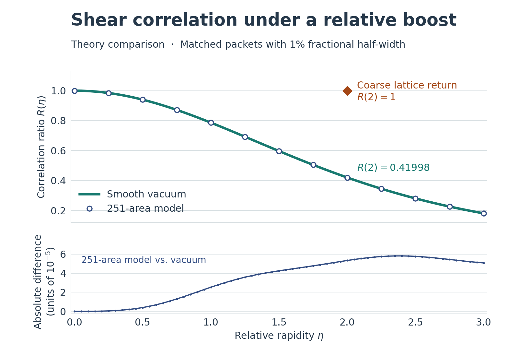

# What could we actually measure?

A measured distortion of light would establish that gravity affected the light. A result specific to this proposed quantization would require a second step. Two theories would have to assign different, calculable probabilities to the same preparation and measurement, with their shared parameters fixed beforehand. At present the paper supplies several quantities to calculate and no verified detector signal that distinguishes it from ordinary low-energy gravity.

## Five worked outcomes

* **A calculation that could test the paper itself.** Compute the fraction of the boost-weighted trace over clock-selected states that falls below half the largest allowed area in the large Schwarzschild ensemble. The paper's one-loop packet assignment gives **0.13816**. Assigning that power to a density per unit area instead gives **0.09770** under the comparison model's assumptions. A count derived independently from the gravitational states could confirm either value or give a third result. Algebraically converting one assumed exponent into its fraction is not an independent calculation of the fraction. [Ensemble calculation](audit/observable-entropy.md)
* **A local gravitational observable.** Launch a beam with a known angular aperture and record the two transverse axes and the on-axis radar time in a specified tidal field. In the worked weak plane wave, strain $10^{-21}$ and frequency 100 Hz across 4 km give ellipticity **$2.34\times10^{-26}$**, optical-distance deficit **$4.39\times10^{-49}$ m**, and zero axial radar-time change. The ordinary differential arm-length signal of an optimally oriented 4 km interferometer at this strain is of order $4\times10^{-18}$ m, about $10^{31}$ times larger than this focusing deficit. The deficit is a classical benchmark for this geometry. A distinct quantum residual would have to be derived. [Optical distances, full diamond and units](audit/observable-optics.md)
* **A spectrum-sensitive quantum observable.** Measure the change in two-sided smeared shear correlations as one normal frame is boosted. For the chosen packet, a hypothetical area lattice with dimensionless spacing $2\pi^2$ restores the normalized correlation to **1** at rapidity 2. The smooth-vacuum benchmark gives **0.41998**. The example’s corner radius is $1.6\times10^{-23}$ m, the assumed spacing is about 79 Planck areas, and the simple covariance protocol would require over a billion ideal pairs per setting. Other, more closely spaced finite spectra can mimic the smooth curve with high accuracy. The paper supplies no particular spacing and no detector implementing this measurement. [Finite-spectrum tests and precision](audit/observable-boost.md)
* **A laboratory target in a broader class of theories.** For a proposed interferometer with two $10^{-14}$ kg masses and a 2.5 s hold, the coherent Newton interaction gives a predicted phase of **$-0.314$ rad** in the specified convention. The calibrated ideal spin-state fidelity is **0.578**, above the separability ceiling of **0.5**. Non-gravitational forces and noise have to be controlled and modeled. The vacuum null-cone theory does not yet predict what two material masses would do. [Four paths and laboratory controls](audit/observable-lab.md)
* **A test of interacting dynamics.** Recover the logarithmic scale dependence of the two-loop low-energy four-graviton hard amplitude with all four helicities positive after applying the same infrared prescription and normalization as the effective theory. The coefficient of $\log(\mu^2/\mu_0^2)$ is **$-1/4$ in units of the specified helicity factor**. This tests gravitational self-interaction. Reproducing the Gaussian boundary overlap does not determine it. [Amplitude conventions](audit/scattering.md)

The isolated point is the required return of a hypothetical coarse area lattice. The lower panel shows how closely a different finite spectrum with 251 area values follows the smooth curve. These are theoretical comparisons. Reproduce the figure with `uv run tools/plot_boost.py`. [Calculation and uniform error bound](audit/observable-boost.md)

## The most informative calculation to do first

Prepare a gravitational wave packet on a diamond whose boundary frame and corner area have been specified. Let the packet have a chosen radial frequency, angular harmonic and polarization. Ask for the probability that the proposed clock reads below a fixed limit. The operational question is whether information encoded in finer ripples remains distinguishable *within the same physical region*. Changing the size as the resolution increases would test a different claim.

For orthonormal packets $e_j$ and the clock projection $P_\ell$, the predicted acceptance probabilities are $p_j=\langle e_j,P_\ell e_j\rangle$. In a theory with exactly $d$ distinguishable states in the clock window, every collection must obey

$$
\sum_{j=1}^{m}p_j\leq d.
$$

To see this, sum the squared overlaps of the input packets with each of the $d$ orthogonal accepted states. Each accepted state's overlaps sum to at most one. This test does not require the surviving packets to be orthogonal. Establish the inequality on the *physical* constrained space as the radial, angular and occupation cutoffs are removed. Divergence of the partial sums would rule out finite rank in that sector. A short plateau in a computer calculation cannot establish an upper limit on all the modes.

A solvable corner example illustrates the danger. At the same clock threshold, its truncated matrices admit 6 states at dimension 16 and 94 at dimension 4096. Its continuum clock is multiplication by a function of a continuous coordinate. Every square-integrable wavefunction supported within the accepted interval is allowed, so we know exactly that there are infinitely many. The next physical question is whether that shape coordinate and its observable survive the gravitational constraints and preserve the clock window. [Numerical program and exact control](audit/regulator-program.md) · [State-count test](audit/finite-kinematics.md)

## A second question the clock cannot answer on its own

Could we tell whether distinct clock-accepted states have distinct areas? A proposed controlled boost would imprint a phase proportional to the area. At small rapidity the loss of squared interference visibility is proportional to the variance of area. Scanning rapidity could distinguish two specified candidate spectra, but assigning additional states to each area while keeping its probability fixed leaves every visibility measurement unchanged. Counting states requires a measurement sensitive to that hidden multiplicity. [First-principles derivation](audit/observable-visibility.md)

## Three questions for every proposed signal

1. **What is the instrument?** Specify what is emitted, what is recorded, which two events or boundary frames define the reading, and the sampling bandwidth. An affine parameter on a ray becomes an observable only after its scale and endpoints have been fixed physically.
2. **What would ordinary gravity predict?** Use the same state, field content, smearing, environment and resolution. Recovering a known shear response, entropy coefficient or scattering amplitude is an essential consistency check. To distinguish theories requires a difference with an uncertainty smaller than the difference.
3. **Which outcome could change the conclusion?** Give the signal, null hypothesis and assumption most likely to fail. For an entropy comparison specify the mass and spin ensemble. For a proposed phase measurement specify the source and detector dynamics. For a proposed discrete spectrum supply the eigenvalues, couplings and linewidths before inferring emission lines.

## Calculation and measurement programs

| Quantity | First result to obtain | What the result would establish |
|---|---|---|
| Focusing of a light bundle | Use a specified tide, a fixed frame and the optical propagation equation to predict a change in the beam area or shape. Translate it into an observed angular size, light intensity or other calibrated optical signal. | Tests the geometric clock's classical interpretation. The leading focusing law is shared with general relativity. [Optical calculation](audit/observable-optics.md) |
| Correlation of shear measurements on opposite sides of a cut | Calculate the response to a relative boost for specified smearings. Derive the precision and range over which a proposed finite spectrum differs from the freely falling vacuum response. | Tests a specified candidate spectrum once its transition weights and a controlled measurement regime have been supplied. The paper gives no microscopic level spacings. [Boost calculation](audit/observable-boost.md) |
| Dependence of black-hole state density on mass, spin and window width | Compute the full determinant with each physical ensemble and vary the width of the area measurement. | Can distinguish a microscopic state count from reuse of a known local coefficient. For a ten-solar-mass black hole the corresponding spin-summed thermodynamic temperature shift is about $-2.25\times10^{-79}$ of the Hawking temperature. The trace fraction itself would require access to the interior ensemble. [Entropy observables](audit/observable-entropy.md) |
| Low-energy four-graviton amplitude | Prepare normalized external packets, remove the infrared regulator consistently and calculate the two-loop scale dependence from the proposed dynamics. | Tests whether this construction has the known self-interactions. The Gaussian pair example does not test those vertices. [Scattering calculation](audit/scattering.md) |
| Gravity-mediated entanglement between masses | Specify four paths, an interaction time, the competing forces and the entanglement witness. | Tests certain classical local mediator models under explicit assumptions. A prediction of this vacuum-only paper for massive matter would require an extension. [Laboratory comparison](audit/observable-lab.md) |

The [comparison of approaches](audit/approaches.md) organizes candidate theories by their physical assumptions and by the observables that can be compared on equal terms. Experimental observability, theoretical calculability and uniqueness to a proposed theory are three different requirements. An experiment can be valuable even when it satisfies only the first two.
