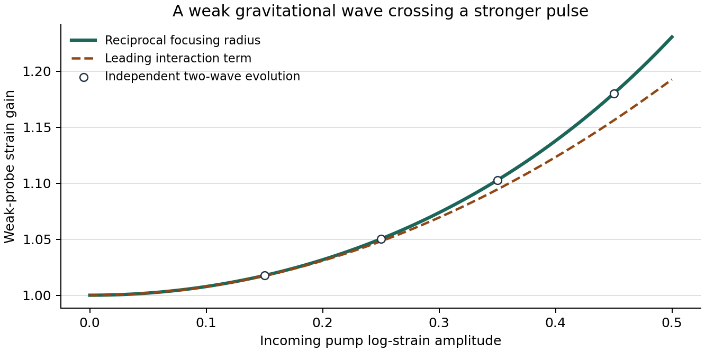

# A finite-region interaction between two gravitational waves

Send a weak gravitational wave through a counterpropagating gravitational pulse in vacuum. At the end of a unit-height $\sin^4$ pulse of log strain $\epsilon$, the weak wave's transverse log strain and its null tidal curvature both acquire the gain

$$
1+\frac{5\pi^2}{64}\epsilon^2+O(\epsilon^4).
$$

The coefficient $0.77106284$ multiplies a response linear in the weak wave and quadratic in the strong one. It follows from the **bulk evolution** of the conformal metric and the **incoming constraint** that relates shear to area. Both equations follow on the invertible, oriented, $\Lambda=0$ branch of Venkatesa Chandrasekaran’s action. The calculation uses the classical vacuum equations throughout the collision. Its linear probe also admits an explicit quantization on the prescribed classical background. [Chandrasekaran, arXiv:2611.34924v1](https://arxiv.org/abs/2611.34924v1) · [First-order field equations (3.4)–(3.8)](https://arxiv.org/html/2611.34924v1#S3.E4)

## The preparations and the measuring frame

Use the sector with two commuting spacelike translations and aligned linear polarizations. Give initially equal transverse displacements along the two polarization axes the labels $X$ and $Y$. Normalize the two incident null generators in the flat region by $\ell\cdot n=-1$ and a specified inertial frame. Let $u$ on $v=0$ and $v$ on $u=0$ be their affine parameters from the wavefront crossing. Continue each label into the collision along the other family of null characteristics. Their intersection specifies an event on the two-dimensional quotient by translations. Measurements are the same everywhere on its transverse orbit.

In these coordinates the metric, transverse area factor and log ratio of lengths are

$$
ds^2=-2e^{-M}du\,dv+A(e^Vdx^2+e^{-V}dy^2),\qquad
A=|X|\,|Y|,\qquad V=\log\frac{|X|}{|Y|}.
$$

Here $X=\partial_x$ and $Y=\partial_y$ have unit norm in the initial flat region. Specifying their normalizations, the incident null frame and the characteristic labels makes the comparison invariant under simultaneous diffeomorphisms of the fields and measuring data. Rescaling the axes or boosting the null frame changes the preparation or the components read by the detector. Work on a finite patch with $A>0$ before focusing. The infinite transverse plane is an idealization of the symmetry of the data. The target concerns a local readout in its domain of dependence. [Griffiths and Santano-Roco, metric (21) and characteristic equations (22)–(27)](https://arxiv.org/pdf/gr-qc/0206075#page=5)

Prepare $V(u,0)=\epsilon f(u)$ and $V(0,v)=\delta g(v)$ with $f(0)=g(0)=0$. Set $M=0$ on both initial sheets and use the initial flat values $A=1$ and $\partial_u A=\partial_v A=0$ at their intersection. The two prescribed functions specify the unit-determinant conformal metric $\bar q=\operatorname{diag}(e^V,e^{-V})$ there and along the corresponding initial sheets.

## Solving through the collision

Write $W=\log A$. For the two transverse scale factors $e^{(W\pm V)/2}$, the sum and difference of the mixed-index vacuum equations $R^x{}_x=R^y{}_y=0$ respectively give

$$
A_{uv}=0,\qquad 2A V_{uv}+A_uV_v+A_vV_u=0.
$$

The remaining mixed equation gives $2M_{uv}=V_uV_v-W_uW_v$. The null constraints on the initial sheets propagate by the contracted Bianchi identity. In the author's affine focusing equation the contraction of the derivatives of $\bar q$ is $2V_u^2$. Consequently,

$$
r_f''(u)=-\tfrac14\epsilon^2 f'(u)^2 r_f(u),\qquad
r_f(0)=1,\quad r_f'(0)=0,\qquad
A(u,v)=r_f(u)^2+r_g(v)^2-1,
$$

where $r_g$ solves the same equation with $\delta g$. These planar congruences start with unit area per unit coordinate area. A light cone based at a smooth vertex has different initial area and expansion. [Chandrasekaran, Eq. (3.25f)](https://arxiv.org/html/2611.34924v1#S3.E25.6) · [Griffiths and Santano-Roco, interaction equation (24)](https://arxiv.org/pdf/gr-qc/0206075#page=6)

At $\delta=0$ the solution is $V=\epsilon f(u)$, $A=r_f(u)^2$ and $M=0$. The probe changes its own initial area first at order $\delta^2$. Hence $P=\partial_\delta V|_{\delta=0}$ obeys $\partial_u(r_f\partial_vP)=0$ with $P(u,0)=0$ and $P(0,v)=g(v)$. On every regular part of the patch,

$$
P(u,v)=\frac{g(v)}{r_f(u)},\qquad
\frac{1}{r_f(u)}=1+\frac{\epsilon^2}{4}\int_0^u (u-s)f'(s)^2\,ds+O(\epsilon^4).
$$

The response $P$ is exact to all orders in the pump amplitude. Its leading mixed term measures how the pump focuses the weak wave. Replacing the pump by $a f_1+b f_2$ gives the trilinear response $\partial_a\partial_b\partial_\delta V|_0=\tfrac12g(v)\int_0^u(u-s) f'_1(s)f'_2(s)\,ds$. For coincident pump shapes the Taylor coefficient of $\epsilon^2\delta$ is half the mixed derivative.

For the readout set $f(s)=g(s)=\sin^4(\pi s/L)$ on $0\leq s\leq L$, zero outside, and use $u=L$, $v=L/2$. These joined profiles are $C^3$. The polarization of the incident pump has returned to zero there and $g(L/2)=1$. The square of the pump derivative is symmetric about $L/2$ and integrates to $5\pi^2/(8L)$. The weighting by $L-s$ and the factor $1/4$ therefore give $5\pi^2/64$. The coefficient is dimensionless and independent of $L$ at fixed dimensionless incident strain.

## What a tidal measurement reads

On the ray $u=L$, take $n=e^M\partial_v$ and the transverse unit vectors $\hat x=X/|X|$, $\hat y=Y/|Y|$. The tangent is affine and agrees with the chosen normal at $v=0$. The transverse axes are parallel transported along it. In the curvature convention of v1, the difference of the two null tidal components is

$$
T=R_{n\hat x n\hat x}-R_{n\hat y n\hat y}
=-e^{2M}\left[V_{vv}+(W_v+M_v)V_v\right],
\qquad
\left.\partial_\delta T\right|_0=-\frac{g''(v)}{r_f(u)}.
$$

The latter expression also holds at fixed affine distance along $n$. The tangent labels agree at zero probe and the background $T$ vanishes along the entire ray, so shifting the evaluation point has zero first variation. At the chosen readout the reference response is $4\pi^2/L^2$. Its fractional gain is exactly the strain gain. Other observables answer different physical questions. For example, $\partial_\delta(\sqrt A\,V)|_0=g(v)$, and the gain cancels in the absolute difference of the two transverse lengths at the pump exit. The specified log ratio or tidal field is essential.

## A quantum calculation with the pump fixed

The linearized probe has a solvable quantum sector. Write its strain perturbation as $\eta$. For variations in the counterpropagating probe data the first area variation vanishes. Substitution of the plane metric in the Einstein action, dropping boundary divergences, gives the following bulk density per unit coordinate transverse area in conformal gauge, in units of $(16\pi G_N)^{-1}$,

$$
-2A M_{uv}-\frac{A_uA_v}{A}+A V_uV_v.
$$

For example, the two-dimensional scalar curvature is $-2e^M M_{uv}$ and its volume density is $e^{-M}$. Varying $M$ gives $A_{uv}=0$, varying $V$ gives its transport equation, and varying $A$ recovers the mixed equation for $M$. The two null constraints used above are imposed before fixing the initial affine gauge. On the pump solution the quadratic polarization density satisfies

$$
r_f^2\eta_u\eta_v=\phi_u\phi_v-\partial_v\!\left[\frac{r'_f}{2r_f}\phi^2\right],\qquad
\phi=r_f\eta .
$$

On the transmitted solutions $\phi$ depends on $v$ alone. The probe symplectic form on $u=\mathrm{const}$ is proportional to $\int (\phi_1\phi'_2-\phi_2\phi'_1)\,dv$. This follows directly by varying the kinetic term. The conformal factor $M$ of the two-dimensional metric enters the gravitational curvature term linearly after integration by parts. Its symplectic pairing with a second probe variation vanishes when both variations have $\delta A=0$. The total derivative above contributes no term for profiles with support away from the endpoints of the integration interval.

For an explicit finite quantization take the two profiles $g$ and $Lg'$, extending the interval into the flat portions where both vanish. Their symplectic pairing is proportional to $-2L\int g'^2\,dv\ne0$. Fix a transverse integration area and rescale the second profile so its coefficient is the momentum $P_Q$ conjugate to $Q$, with $[Q,P_Q]=i\hbar$ in the one-pair representation. The coefficient $Q$ of $g$ then equals $\phi(L/2)$, since $g(L/2)=1$ and $g'(L/2)=0$. Prepare a Gaussian state with $\langle Q\rangle=\delta$ and $\mathrm{Var}(Q)=\sigma^2$. On the pump exit the characteristic function of the probe strain is

$$
\left\langle e^{it\hat\eta(L,L/2)}\right\rangle
=\exp\!\left(\frac{it\delta}{r_f(L)}-\frac{t^2\sigma^2}{2r_f(L)^2}\right).
$$

At this readout the odd derivatives $g'(L/2)$ and $g'''(L/2)$ vanish, so the linearized tidal operator in this pair is $(4\pi^2/L^2)\hat\eta(L,L/2)$. This finite symplectic subspace evolves exactly under the linear probe equation. Both its mean and standard deviation scale by $1/r_f$. The bounded Weyl observable uses a single linear quadrature and introduces no product-ordering choice. Its nonlinear dependence on $\epsilon$ comes from the classical solution chosen for the pump. The probe’s own quadratic stress, including its vacuum contribution, has been omitted. Graviton fluctuations of the pump, higher orders in the probe and a continuum limit for the quantum metric require additional calculations.

## Reproduction and scope

From the repository root, run `python3 checks/interacting_test.py` or include it with `make check`. The check integrates both incoming constraints, then marches the full finite-amplitude $A,V,M$ characteristic equations through the overlap. Reversing the sign of the probe extracts the odd response at $|\delta|=0.001$. It extrapolates the strain coefficient in the pump amplitude from $0.04,0.02$ and the tidal derivative in the grid spacing. The last printed digits can vary with floating-point rounding. [Executable check](../checks/interacting_test.py)

```text
80 cells per side: cubic strain coefficient = 0.77106276
160 cells per side: cubic strain coefficient = 0.77106276
analytic cubic coefficient = 0.77106284
pump 0.35: two-wave probe gain = 1.10274445, linear-probe prediction = 1.10274446
pump 0.35: extrapolated tidal gain = 1.10274423
```



For the plotted unit pulse, the continuous curve integrates the incoming constraint and the four points evolve both incident waves on a null grid. The dashed curve keeps only the leading correction to the gain. Run `uv run tools/plot_wave_transfer.py` to rebuild `figures/wave-transfer.png`. [Plot source](../tools/plot_wave_transfer.py)

**The remaining proof gap.** The two planar initial characteristics define a local Einstein solution. To apply the test to the proposed quantum diamond, restrict that solution to a regular cone and cap, prepare states peaked on their induced data, and dress the readout with the same geometric labels. Evaluate the odd-probe response with the proposed propagator at fixed physical smearing and control both the classical and regulator limits. For a finite smearing the target is the correspondingly smeared $-g''/r_f$. The $5\pi^2/64$ result supplies a finite-region benchmark with both incident waves present. The factor probes classical gravitational self-interaction. A flat-space four-graviton $S$-matrix requires asymptotic packets with specified normalization, and a loop correction requires internal quantum fluctuations. [Manuscript, cap evolution §4.3](https://arxiv.org/html/2611.34924v1#S4.SS3) · [Semiclassical limit §6.1](https://arxiv.org/html/2611.34924v1#S6.SS1) · [Separate on-shell amplitude benchmarks](scattering.md)
