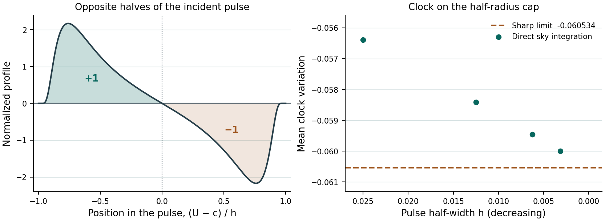

# A sharp angularly averaged clock on a diamond with two smooth tips

Venkatesa Chandrasekaran's capped clock multiplies the affine distance from the inner cut to the waist by the optical slope at the inner cut. In a four-dimensional vacuum plane wave we calculate this clock on the *spherical light cones of two events*, including the motion of their intersection. A sequence of smooth linearized vacuum solutions gives a nonzero variation of the angularly averaged clock while its symplectic pairing with every smooth metric perturbation on a spacelike ball spanning the waist tends to zero. This rules out a smooth Hamiltonian vector for the sharp measurement with the ordinary Einstein current and a commonly matched internal cut. An independently marked external cap can carry additional charges. [Version 1, Eqs. (3.27)–(3.28)](https://arxiv.org/html/2611.34924v1#S3.E27) · [Einstein current, Eq. (A.6)](https://arxiv.org/html/2611.34924v1#A1.E6)

## The two cones and the calibrated clock

Use a linearly polarized vacuum plane wave in Rosen coordinates,
$$
 ds^2=-2\,dU\,dV+A_1^2(U)\,dx_1^2+A_2^2(U)\,dx_2^2,
 \qquad A_{1,2}=R e^{\pm H/2}.
$$
The only possibly nonzero Ricci component is $R_{UU}=-(A_1''/A_1+A_2''/A_2)$. Thus prescribing any smooth $H$ and solving $R''=-R(H')^2/4$ gives vacuum wherever $R>0$. Fix $p=(0,0,0,0)$ and $q=(L,D,0,0)$, $L,D>0$, with $A_i(0)=1$. Use the rest frame $t=(\partial_U+\partial_V)/\sqrt2$ at each vertex and orthonormal transverse axes there. Null rays have conserved slopes $k_i=A_i^2 dx_i/dU$, since $U$ is affine and the $x_i$ are cyclic. For $L=D$, the vertices lie on the central timelike geodesic with tangent $t$, at fixed proper separation $\sqrt{2}L$. Its parallel-transported transverse frame is $A_i^{-1}\partial_{x_i}$. The optical data below are those of the two point-vertex congruences. [Plane-wave geodesics, Eq. (2.11)](https://arxiv.org/abs/1704.05997)

Define
$$
 I_i(U)=\int_0^U A_i^{-2}dz,\quad T_i=I_i(L),\quad J_i=T_i-I_i,
 \qquad F(U)=\sqrt{A_1 A_2 I_1 I_2},\quad
 Z(U)=\log\frac{A_1 I_1}{A_2 I_2}.
$$
On the $p$ cone, $x_i=k_i I_i(U)$ and $2V=\sum_i k_i^2 I_i(U)$. On the $q$ cone, $2(D-V)=\sum_i x_i^2/J_i(U)$. Hence the waist coordinate $s(k)$ solves
$$
 \sum_i k_i^2 \frac{I_i(s)T_i}{J_i(s)}=2D.                              \tag{1}
$$
Every summand increases with $s$ for nonzero $k_i$. The two poles are $s(0)=L$ and $s(\infty)=0$, and each level $0<s<L$ is a regular ellipse. The opposite cone's transverse momenta are $-k_i I_i(s)/J_i(s)$ in the $U$ parametrization. Equation (1) therefore includes the actual intersection and its angular identification on both faces.

The metric on $U=\mathrm{const}$ sections of the $p$ cone is $\sum_i(A_i I_i)^2 dk_i^2$. The degeneracy along each generator gives the same expression evaluated at $U=s(k)$ on the waist. The tip normalization $-t\cdot\ell=1$ fixes $dU/d\lambda=a(k)=\sqrt{2}/(1+|k|^2/2)$ and the solid angle is $d\Omega=a^2d^2 k$. Consequently $\rho=F/a$ and $\partial_\lambda\rho=F'$. Let $b(k)$ refer to the $U$ coordinate on the fractional cap $C$ defined by $F(b)=\epsilon F(s)$ with $0<\epsilon<1$ and $F'>0$. The single-ray and averaged clocks are
$$
 u_*(k)=\frac{F'(b)}{a}(s-b),\qquad
 \bar u_*=\frac{\mathcal N}{\mathcal D}
 =\frac{\int_{\mathbb R^2} F(s) F'(b)(s-b)\,d^2 k}
        {\int_{\mathbb R^2} a F(s)\,d^2 k}.                              \tag{2}
$$
In particular the angular weight in this measurement is $\rho_S\,d\Omega$. Fixing the tip labels $k$ while varying the solution fixes their physical meaning because all the variations below vanish near $p$. The cap is allowed to move to maintain its area fraction. [Cap boundary data, Eq. (3.18)](https://arxiv.org/html/2611.34924v1#S3.E18) · [Affine normalization and focusing, Eqs. (3.25)–(3.28)](https://arxiv.org/html/2611.34924v1#S3.E26)

## Localizing the variation

Choose the curved background $A_1=\cosh U$, $A_2=\cos U$, $L=D=1$. Both scale factors stay positive. Their independent Jacobi lengths from either tip are proportional to $\sinh(\Delta U)$ and $\sin(\Delta U)$, where $0<\Delta U\leq1$. Both cones have smooth vertices and positive optical slope up to their common waist, including the axial generators by continuity. In particular $F=\sqrt{\sinh U\sin U}$ and $Z'=\coth U-\cot U>0$ away from $p$. The affine polarizations obey $F''=-F(Z')^2/4$.

On the central generator set $c=F^{-1}(\epsilon F(L))$. Use a compactly supported smooth function $f$ on $[-1,1]$ such that $\int f=0$ and $\int_{-1}^0 f=1$. For every sufficiently small width $h>0$, vary the exact vacuum family by
$$
 H\longmapsto H+t f_h,\qquad f_h(U)=h^{-1}f((U-c)/h).
$$
Solve the vacuum equation for $R$ with the original tip data at $p$ and denote the derivative at $t=0$ by $\delta_h$. Each direction is tangent to a family with smooth vertices and regular cones, taking $t$ small enough for its specified width. The proof takes a limit of these derivatives. It assumes no common finite amplitude as $h\to0$.

Write $w=\delta_h R/R$. Differentiating the exact equation gives
$$
 w'=-\tfrac12 H'f_h+\frac{1}{2R^2}\int_0^U (R^2H')'f_h\,dz,\qquad
 (\delta_h I_{1,2})'= I_{1,2}'(-2w\mp f_h).
$$
Consequently $w,\delta_h I_i,\delta_h F$ are bounded in the packet and $O(h)$ outside. This uses the zero integral of $f$ against the constant part of each smooth coefficient. From $F=R\sqrt{I_1I_2}$ one obtains
$$
 \delta_h F'(U)=-\tfrac12 F(U)Z'(U) f_h(U)+e_h(U),                       \tag{3}
$$
where $e_h$ is bounded within $|U-c|\le h$ and $O(h)$ outside (on intervals separated from $p$, and all variations vanish before the packet). This derivative is the optical-slope term at the inner cut.

At fixed $k$, differentiate (1) for $\delta_h s$ and use
$$
 \delta_h b=\frac{\epsilon[\delta_h F(s)+F'(s)\delta_h s]-\delta_h F(b)}{F'(b)}.
$$
Here and in (3), $\delta_h F$ at a stated argument denotes the profile variation at fixed $U$. Both $\delta_h s$ and $\delta_h b$ are bounded and $O(h)$ outside the bands $|s-c|\le h$ and $|b-c|\le h$. The waist band is a regular belt of area $O(h)$. For large $|k|$, $s=O(|k|^{-2})$ and $\delta_h s=O(hs^2)$, as follows from the dependence of (1) on $T_i$ at small $s$. All tails of the differentiated integrals in (2) are integrable.

The cap band is different. Near $k=0$ the true intersection and the fractional cut give
$$
 b(k)=c-k^T E k+O(|k|^4),\qquad
 E_{ii}=\frac{\epsilon F'(L)}{F'(c)}
         \frac{A_i(L)^2 T_i^2}{2D}>0,\quad E_{12}=0.                       \tag{4}
$$
The critical point is a maximum of $U$ on a regular spacelike cut, with no geodesic caustic. Its neighborhood $c-h\le b\le c$ has angular area $O(h)$. Thus all bounded band contributions to (2) vanish on integration, including those from the movement of $s$ and $b$, the variation of the waist weight, and $e_h(b)$. The remaining term is proportional to $f_h(b)$. In the scaled coordinates $k=\sqrt h\,E^{-1/2}z$, its integral against a smooth weight tends to the value at $k=0$ times $\pi(\det E)^{-1/2}\int_{-1}^0 f$. The cap reaches only the lower half of the compensated packet. Equations (2)–(4) give
$$
 \boxed{\displaystyle
 \lim_{h\downarrow0}\delta_h\bar u_*=
 -\frac{\pi F(L)(L-c) F(c) Z'(c)}{2\mathcal D\sqrt{\det E}} .}             \tag{5}
$$

There is a calibration control on the same physical rays. The clock measured from the smooth vertex has $F'(0)=1$. Subdividing it at $C$ gives the exact identity
$$
 \frac{s}{a}=\frac{b}{a}+\frac{1}{F'(b)}\,u_*(k).
$$
The sharp term in $\delta_h u_*$ cancels against the derivative of the conversion factor $1/F'(b)$. The remaining vertex-calibrated measurement depends only on $s$ and has vanishing averaged first variation in this sequence. The nonzero limit (5) detects resetting the calibration at the cap. [Transfer across adjacent cuts](joint-clock.md)

## What the symplectic test excludes

Take a smooth spacelike three-ball $B$ spanning $S$ in this solution. Compare the Einstein current on $B$ with its integral over the incoming null face and adjoining spacelike cap, using one smooth metric and a common identification through $C$. Conservation for smooth linearized solutions transports the current through this interior joint. Oppositely oriented copies of any common local improvement cancel there. For any smooth linearized metric $X$, the current $\omega(X,\delta_h g)$ is a smooth-coefficient linear expression in $\delta_h g$ and its first spacetime derivatives. On this family these are sums of smooth coefficients times $f_h$, its derivative and the optical integral variations above. Derivatives of the latter may be reduced by their transport equations. Since $dU$ is null and nonzero, its restriction to a spacelike $B$ never vanishes. Near $U=c$ its restriction to $S=\partial B$ is also nonzero by (1). Thus the integral of each smooth test coefficient over the level sets of $U$ in $B$ or $S$ is smooth near $c$. The zero full moment of $f_h$ implies $f_h\to0$ and $f_h'\to0$ against all these tests. Bounded collar terms have volume $O(h)$, and ordinary tails are $O(h)$. It follows that
$$
 \lim_{h\downarrow0}\int_B\omega(X,\delta_h g)=0 .
$$
This contradicts (5) for a smooth $X$ representing $d\bar u_*$ with that metric two-form. The variations of the geometric waist embedding and angular map in (1) are bounded in its regular belt and small outside it in regular charts. Smooth local linear functionals of those variations and their tangential derivatives also vanish after integration by parts on $S$. The fixed-tip construction tests both boundary cones of one smooth vacuum solution.

An external physical cap can retain its own relative boost, angular identification, or conjugate corner momenta. Its symplectic pairing lives at $C$, where the transversality argument fails. This can be seen in the same solution. Take the affine tangent $l$ with $l(U)=1$ and let $e_i$ be the tangent to a constant-$U$ section in the $k_i$ direction. The parallel vector $n_0=\partial_V$ has $n_0\cdot l=-1$. On the graph $U=b(k)$ the cut tangents are $e_i+b_i l$, $b_i=\partial_i b$. Its other null normal is $n=n_0+\nabla^i b\,e_i+|\nabla b|^2l/2$, with the section metric used to raise indices. From the null second fundamental form the normal connection is therefore $\varpi_i=-n\cdot\nabla_{e_i+b_il}l=-[\log(A_i I_i)]'b_i$ (no sum). Rescaling $l$ by the fixed tip factor $a(k)$ adds a fixed angular gradient.

Near the central generator, varying this expression gives $\delta_h\varpi_i=\mp\tfrac12\partial_i[f_h(b)]+o_{\mathcal D'}(1)$, with the upper sign for $i=1$. Indeed, the only differentiated pulse is $\pm f_h'(b)/2$ in the variation of $A_i'/A_i$. Terms proportional to $b_i f_h(b)$ vanish weakly because $b_i=O(|k|)$ there. The cut displacement $\delta_h b$ and its angular derivative vanish as distributions. Write $M=\pi/\sqrt{\det E}$. By (4), $f_h(b)\to M\delta^{(2)}(k)$. At the cap, the area measure is $F(b)^2d^2k$. Hence for a smooth relative angular displacement $Y$ supported near this generator,
$$
 \lim_{h\to0}\int_C Y^i\,\delta_h(\mu_C\varpi_i)=
 \frac{M F(c)^2}{2}\big(\partial_1Y^1-\partial_2Y^2\big)_{k=0}.
$$
Orientation and the action coefficient supply the prefactor when this integral enters a symplectic form. This term can detect the packet if the relative frame is independent. Determining whether it supplies the clock generator requires the Hamilton equations for the other admissible cap variations as well. [Angular corner contribution from the metric current](rim-potential.md)

The smooth-vector obstruction applies when the two sides share one continued geometry and the symplectic form transports to the metric current on $B$, with at most smooth outer-waist terms of the stated kind. It leaves the independent marked-cap reduction and a distributional Peierls bracket open. It does not determine the clock's quantum domain or spectral rank. [Moving-frame potential, Eq. (B.21)](https://arxiv.org/html/2611.34924v1#A2.E21)

## Keeping the total waist area fixed

The weak limit in (5) survives an additional constraint on the total area even if both tips stay fixed. Take $A_1=\cosh(\kappa U)$ and $A_2=\cos(\kappa U)$ at sufficiently small nonzero $\kappa L$. Write $F_\kappa(s)=\sqrt{\sinh(\kappa s)\sin(\kappa s)}/\kappa$. In (1) the two coefficients of $k_i^2$ are $m_i(s)=J_i^0(s)J_i^0(L)/J_i^0(L-s)$, where $J_1^0(s)=\sinh(\kappa s)/\kappa$ and $J_2^0(s)=\sin(\kappa s)/\kappa$. The angular-plane area enclosed by the ellipse at $s$ is $2\pi D/\sqrt{m_1m_2}=2\pi D F_\kappa(L-s)/[F_\kappa(s)F_\kappa(L)]$. Integration by parts against $F_\kappa(s)^2$ gives

$$
\mathscr A=\frac{4\pi D}{F_\kappa(L)}\int_0^L F'_\kappa(s)F_\kappa(L-s)\,ds
 =2\pi DL\left[1+\frac{(\kappa L)^4}{540}+O((\kappa L)^8)\right].
$$

The expansion follows from $F_\kappa(s)=s-\kappa^4s^5/180+O(\kappa^8s^9)$. Analyticity implies $\partial_\kappa\mathscr A\ne0$ for sufficiently small positive $\kappa$. The uncorrected narrow pulse changes the area by $O(h)$ because $U=c$ is a regular level at the waist. By the implicit-function theorem one can adjust $\kappa$ in each exact pulsed family to hold $\mathscr A$ fixed. The compensating tangent is $O(h)$ along a fixed smooth background variation, so it contributes zero to both limits. This argument fixes one number, the integrated waist area. Angle-by-angle matching still has its own equations. The numerical example below uses the original fixed-tip family at $\kappa=1$.

## Numerical check

Run `python3 checks/joint_focal.py` and `make check` from the repository root. The focused check differentiates (1) and (2) at fixed physical tip angle, integrating the two optical integrals and the variation of the exact vacuum equation. It uses $f(x)=\partial_x\exp[1-1/(1-x^2)]$ on $|x|<1$, extended by zero, and $\epsilon=1/2$. The independent limit uses (5). For a second evaluation of the denominator in (2), integrate by parts in the waist coordinate and use the azimuthal average of $\log(m_1\cos^2\phi+m_2\sin^2\phi)$. This gives $\mathcal D=4\pi\sqrt2\int_0^L F'(s)\log[(\sqrt{m_1+D}+\sqrt{m_2+D})/(\sqrt{m_1}+\sqrt{m_2})]ds$ and agrees with the direct sky integration. Expected output is below, and the full suite should exit successfully. [Executable check](../checks/joint_focal.py)

~~~text
width 0.025000: clock variation -0.056389, limit -0.060534
width 0.012500: clock variation -0.058410, limit -0.060534
width 0.006250: clock variation -0.059459, limit -0.060534
width 0.003125: clock variation -0.059993, limit -0.060534
~~~

The signed areas of the two halves in the left panel are $+1$ and $-1$. The cap's maximum samples the earlier half in the angular integral. The points in the right panel use the full two-cone calculation; the dashed line uses (5). Run `uv run --script tools/plot_joint_clock.py` to regenerate `figures/joint-clock.png`. [Plot source](../tools/plot_joint_clock.py)
