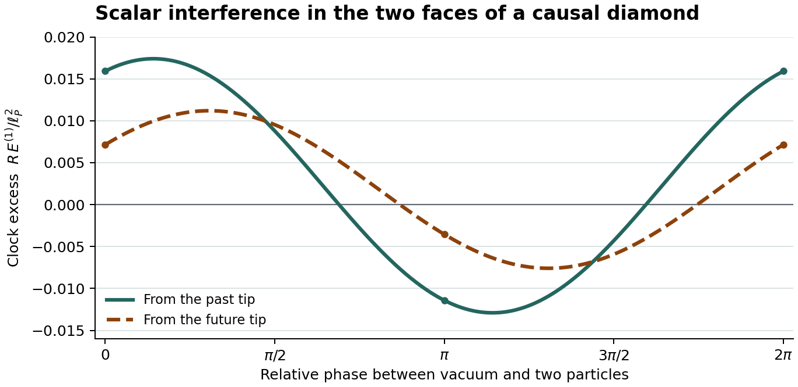

# Scalar interference in a geometric clock

A direct extension of the classical area bound to quantum matter would assume that renormalized matter still focuses every finite light bundle on average. An explicit pair of states tests this assumption. In the leading semiclassical Einstein equation a spherically symmetric massless scalar gives either sign of the clock excess at the same total mean energy. The sign is controlled by the relative phase between vacuum and two particles. The calculation uses the standard weak-field matter theory against which a proposed extension of the null-cone quantization can be tested. [Vacuum construction, §3.2](https://arxiv.org/html/2611.34924v1#S3.SS2) · [Fewster and Roman on quantum null energy](https://doi.org/10.1103/PhysRevD.67.044003)

## Preparation and geometric observable

Work in $c=\hbar=1$ with a minimally coupled free real scalar. Define the renormalized stress by Minkowski vacuum subtraction and set the cosmological constant to zero. In the flat reference diamond take the past tip at $(t,r)=(0,0)$ and the future tip at $(2R,0)$. On its expanding cone the affine generator is $k=\partial_t+\partial_r$ and $t=r=u$. Denote the physical corner area radius by $r_S$; place the cap at the fixed ratio $r_c/r_S=\epsilon$. The quantity compared is the excess $E=u_*-(1-\epsilon)r_S$, where $u_*=r'_c(u_S-u_c)$. Spherical symmetry removes the shear of the mean geometry and makes the reading equal in every angular direction.

The radial Einstein equation gives $r''=-4\pi G r\,\langle T_{kk}\rangle_{\rm ren}$ for the mean metric. Integrating twice with these endpoint conditions gives a kernel $(u_S-u)r(u)$ for $E$. Its leading coefficient is therefore
$$
 E^{(1)}=4\pi G\int_{\epsilon R}^R (R-u)u\,
             \langle{:}(k\partial\phi)^2{:}\rangle\,du .
$$
Here $k\partial\phi$ denotes $k^\mu\partial_\mu\phi$. Perturbations of the radius, affine normalization and endpoints inside this integral first contribute at higher order because the integrand already carries a factor of $G$ and the state has a smooth stress expectation. Defining $E$ with the physical $r_S$ also cancels the displacement of the corner in the endpoint term. Each cone has its own cap-to-corner excess. The same geometric identity holds with affine distance increasing away from the future tip on the other sheet. The central observer’s round-trip proper time is a different observable.

## A normalized spherical wave packet

Use positive-frequency spherical modes and one normalized packet of width $a>0$,
$$
 f_\omega(t,r)=\frac{e^{-i\omega t}\sin(\omega r)}{2\pi r\sqrt\omega},
 \qquad c_a(\omega)=2a\sqrt\omega\,e^{-a\omega}.
$$
The Klein–Gordon product gives $(f_\omega,f_{\omega'})=\delta(\omega-\omega')$ and $\int_0^\infty |c_a|^2d\omega=1$. Integrating the packet yields
$$
 f(t,r)=\frac{a}{\pi[(a+it)^2+r^2]},\qquad
 f(u,u)=\frac{1}{\pi(a+2iu)},\qquad k\partial f(u,u)=\frac{-2i}{\pi(a+2iu)^2}.
$$
This solution is smooth at the centre. Choose $a=R$, $\epsilon=1/2$ and $\lambda=1/10$. With $b$ the packet annihilation operator, set $|2_f\rangle=(b^\dagger)^2|0\rangle/\sqrt2$ and prepare
$$
 |\psi_\pm\rangle=\frac{|0\rangle\pm\lambda|2_f\rangle}{\sqrt{1+\lambda^2}} .
$$
Both states have $n=\langle b^\dagger b\rangle=2\lambda^2/(1+\lambda^2)=2/101$ and total mean energy $n/a$, since $\int \omega |c_a|^2d\omega=1/a$. They differ in $m_\pm=\langle b^2\rangle=\pm\sqrt2\lambda/(1+\lambda^2)$. All orthogonal modes are in their vacuum. Normal ordering gives $2n|k\partial f|^2+2\operatorname{Re}[m_\pm(k\partial f)^2]$ for the stress on the ray. The second term is the vacuum–pair interference; an incoherent mixture with the same number probabilities has $m=0$.

## Signed prediction

With $x=u/R$, write $w=x(1-x)$, $g=-2i/[\pi(1+2ix)^2]$. The diagonal and interference integrals are elementary:
$$
 A_0=\int_{1/2}^1w|g|^2dx=
 \frac{1/8+\pi/16-\arctan(2)/4}{\pi^2},
 \qquad B_0=\int_{1/2}^1wg^2dx=\frac{23-11i}{600\pi^2}.
$$
Thus $R E^{(1)}_\pm/G=4\pi[2n A_0+2\operatorname{Re}(m_\pm B_0)]$. The minus preparation gives **−0.011421097**, and the plus preparation gives **+0.015915240**. Restoring units, the two leading shifts are those numbers times $\ell_P^2/R$. They refer to the same flat reference size and cap prescription. The computed signs apply for $R\gg\ell_P$ at the indicated order. Both states have positive mean energy. A finite segment samples stress with a nonuniform weight, so positivity of the total Hamiltonian imposes no positivity condition on this integral. The numerical script checks the normalization in position space and the stress integral directly against its analytic value. Run `python3 checks/matter_null_energy.py`. [Executable calculation](../checks/matter_null_energy.py)

### The other cone of the same diamond

The state and the phase need no adjustment on the second sheet. Parametrize its flat generators by $(t,r)=R(2-x,x)$ with $x$ increasing from the future tip toward the waist. Differentiating the same packet gives the dimensionless derivative and integrals
$$
 g_{\rm future}(x)=\frac{2i}{\pi(1+2i)[1+2i(1-x)]^2},
 \quad A_{\rm future}=\frac{3/8-\pi/16}{5\pi^2},\quad
 B_{\rm future}=\frac{9-13i}{600\pi^2}.
$$
The predicted future-tip coefficients $R E^{(1)}/G$ are **−0.003546712** for the minus preparation and **+0.007150115** for the plus preparation. The minus state therefore reduces the classical cap-to-waist excess on both faces of the same spherical diamond at leading order. One need not assume time-reflection symmetry of its stress.

### Continuous change of phase

Give the two-particle amplitude the phase $e^{i\theta}$. The sign states above are $\theta=0,\pi$. The energy stays fixed for the full cycle. In the expression for either sheet one replaces $m_+$ by $m_+e^{i\theta}$, so the phase enters through $\operatorname{Re}(e^{i\theta} B)$ with the sheet's own complex $B$. Both clock excesses are negative throughout the intersection of their negative intervals, approximately $0.868665<\theta/\pi<1.594616$. The limits denote zeros rounded to six decimal places. Suppressing coherence between the vacuum and two particles removes the phase dependence and leaves the small positive diagonal term on each face.

The curves give the first-order mean-metric prediction at fixed mean energy, referenced to flat space at the physical waist area, with packet width $a=R$ and cap fraction $1/2$. Run `uv run tools/plot_scalar_clock.py` to rebuild `figures/scalar-clock-phase.png`. The calculation above also checks the complex interference term at $\theta=\pi/2$ and prints the zeros separately for each sheet. [Plot source](../tools/plot_scalar_clock.py)

## Implication for extending the construction

The negative sign supplies a counterexample to imposing $E^{(1)}\geq0$ on every scalar state while retaining the standard renormalized semiclassical response. Earlier work established much more general negative null energies in four-dimensional flat-space quantum field theory; the result here is the evaluation with the finite diamond's focusing kernel and explicit energy-matched preparations. [Fewster and Roman](https://doi.org/10.1103/PhysRevD.67.044003)

The stress **expectation** is smooth in these finite-particle wave packets. We integrate that expectation, without assuming that a sharply null-smeared stress operator has a well-defined variance. The semiclassical response is a statement about a mean metric, with graviton fluctuations omitted. Comparing quantum expectation values of the full geometric clock and area would also require their composite-operator definitions, boundary dressing, smearing and state-dependent correlations. Large stress fluctuations can matter to a single clock reading. A complete matter theory could alter the bound, add compensating quantum terms, or reproduce the signed response without a sharp area inequality. None of these alternatives is selected by version 1, whose four-dimensional state-count claim concerns vacuum gravity.
