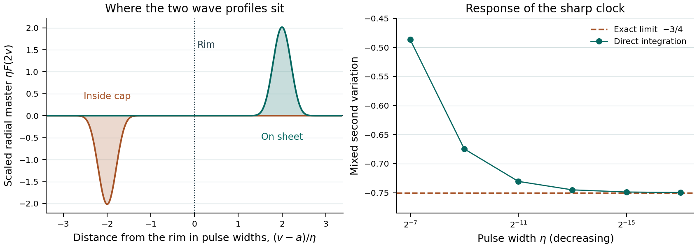

# Does equal geometry at a cap rim leave an angular charge?

**A face can carry angular momentum while its rim metric agrees exactly with the adjacent face.** A common rotation of a smooth internal seam has zero net charge. Independently anchored frames can retain a charge for their relative rotation. For the sharp clock, a one-sided angular term can reproduce one quadrupole matrix element. A second vacuum-wave test rules out a continuously differentiable family of smooth clock generators through flat space with the joined Einstein current and ordinary local frame charges. A further argument using arbitrary radial wave profiles extends the obstruction to a class of nonlocal frames. [Chandrasekaran v1, boundary data](https://arxiv.org/html/2611.34924v1#S3.E19) · [Angular and boost charges at the waist](https://arxiv.org/html/2611.34924v1#S3.E66)

## What the matching equation fixes

Use a comparison map $Y$ to identify the angular labels on the two faces at the rim. Write $q_\pm$ for their induced two-metrics, $h_\pm=\delta q_\pm$ for their variations in the two fixed side charts, and $w=(dY)^{-1}\delta Y$ for the comparison velocity expressed on the plus face. Differentiating the exact metric identification gives
$$
q_+=Y^*q_-,\qquad h_+-Y^*h_-=\mathcal L_wq_+.
$$
If the two marked metrics are held fixed ($h_+=h_-=0$), the remaining angular freedoms are isometries of $q_+$. A rotating sphere separates a **one-sided** charge from a **common smooth seam**. On an exterior Boyer–Lindquist sphere of a Kerr black hole, reversing the spin $J$ leaves the marked two-metric unchanged, yet its one-sided axial charge reverses and equals $-J$ in the orientation used here. Across a smooth internal join through that same Kerr sphere, the adjacent face contributes $+J$, so the two oriented charges of a common rotation add to zero. Joining $+J$ and $-J$ data with the identity identification would instead violate angular momentum matching. Kerr supplies an exterior collar with an inner boundary carrying the balancing flux; on an axisymmetric vacuum ball with a regular interior and no inner boundary, the momentum constraint itself forces the axial flux through the rim to vanish. [Exact Kerr integral](match-rotation.md)

Angular momentum at a rim also depends on how the normal plane varies along the surface. With cap unit normals $T,s$, write the outgoing null generator as $\ell=e^b(T+s)$. In a common chart, the angular normal connection of the sheet obeys $\varpi_A=K_{As}+D_A b$, where $K$ is the cap extrinsic curvature. On a common smooth seam, the two face momenta carry opposite orientations, and accounting for the normal-frame change cancels the $D_A b$ term as well. For this cancellation, the two faces must share both the tangential displacement **and** the normal boost derivative; a vector field that vanishes on the rim can still generate a normal boost there. Conversely, independently prepared vacuum cap and sheet data can match $q$ and both null second fundamental forms while their calibrated normal connections, and a corresponding Weyl curvature component, disagree. Such data fail smooth gravitational matching. [Charge from the action](match-action.md) · [Independent characteristic data](match-independent.md) · [Geometric cap tilt](match-boost.md)

In the two-frame cotangent model for separately anchored angular frames, removing their common motion leaves a relative boundary coupling whose angular part on the matched momenta is $\int_C J_-(\delta Y\circ Y^{-1})$ (accompanied by a relative boost term). A coordinate relabeling of a single internal seam carries no such operational interpretation. At a round cap of radius $1/3$, the single-packet quadrupole slide $G_N\nabla P_2$ (with $P_2=P_2(\cos\theta)$) generates trace-free strain on the sphere, whereas a relative normal displacement compensates only the trace. Consequently, if the two marked metric variations have equal trace-free parts, the round quadrupole angular pairing vanishes. If instead the *marked metrics vary by pullback* ($h_+-Y^*h_-=\mathcal L_w q_+\ne0$), exact geometric matching still holds along a nonzero slide. A vacuum Kasner collar realizes this marked geometry. If the relative potential is retained, its two-form has a matrix element equal to the $-1/30$ Hessian computed independently for the spherical two-tip clock. The collar calculation evaluates only the relative angular term. Chandrasekaran v1 displays a relative-frame coupling at the two-null waist; deriving surviving observables at an isolated cap requires specifying their physical marking. [Comparison-map derivation](match-reduction.md) · [Kasner collar](match-independent.md) · [v1, cap joint](https://arxiv.org/html/2611.34924v1#A1.E18)

The same matching condition can be tested at a curved rim. For the specified shrinking compensated vacuum pulse on a two-tip Rosen diamond, the full smooth displacement charge at the regular cap point where the pulse coordinate reaches its maximum is proportional to the difference of the two fractional principal stretches of the induced metric. Preserving the full rim metric sets this difference to zero even when the angular and normal pieces are individually nonzero: for a parallel null translation they give $-0.063558+0.063558=0$ in the chosen orientation and units. Even if the two smooth metric responses are varied separately on this background, the sum of their ordinary Einstein currents samples precisely the jump of their principal strains for the specified moving-cut test. Matching the induced metric variations makes this sum vanish. The independent clock variation in this same experiment tends to $-0.060534$. [Full curved surface charge](match-curved.md) · [Clock in the same geometry](joint-focal.md)

## Which waves the clock sees

Take a flat diamond of unit waist radius with a round cap at normalized area radius $v=a=1/3$. Prepare two smooth, transverse-traceless vacuum quadrupole packets of opposite sign—one inside the cap, one on the null sheet—separated by a small open gap around the rim. Each test is an allowed infinitesimal vacuum wave (its permitted nonlinear amplitude may shrink with its width). For these particular waves the integrated null transport equations have endpoint primitives that vanish after each complete pulse. The cut embeddings, geometry and ray-transported frames at the rim and waist therefore return to their flat values at first order. Every local angular, boost, and displacement charge of finite differential order therefore vanishes on the test when independent local marks are held fixed. At the same time, on a smooth spacelike disk spanning the waist, the two opposite-sign packets approach the same distribution with opposite signs as they narrow, so their combined Einstein symplectic pairing with any fixed smooth bulk perturbation tends to zero; conservation transports this vanishing pairing to the joined cap and null sheet whenever both faces share one smooth metric. Yet the sharp clock integrates only from $v=a$ to $1$ and sees only the outer packet. [Packet preparation and optical transport](match-packets.md)

Let $D=\bar u_*-(1-a)M$ be the clock excess over the shear-free reading at the same sky-weighted radius $M$. Because focusing is quadratic in shear, $D$ is critical ($dD=0$) at flat space. Write $G_W,G_Z$ for the first-order conformal screen strains of a fixed reference wave $W$ and the signed test pair $Z$. With the stated sky normalization, their mixed second variation is
$$
 d^2D(W,Z)=\frac3{20}\int_a^1 v(1-v)G'_W(v)G'_Z(v)\,dv .
$$
Choose a reference wave with $G'_W(v)=(v-a)^5+O((v-a)^6)$ and give each unsigned radial master profile unit mass in $v$. Because $W$ has vanishing rim strain and slope through fourth order, this test is independent of the single-packet $-1/30$ coefficient (which uses unit rim slope in $W$ and unit rim strain in a single packet $Z$). Integrating by parts leaves only the outer packet and gives the exact limit $-3/4$; direct numerical evaluation of the strain integral at width $2^{-17}$ gives $-0.74969107$. Like $-1/30$, this number is a calibration-dependent **mixed second derivative**; the contradiction lies in its nonzero limit. On a regular reduction, a continuously differentiable ($C^1$) family of smooth Hamiltonian vectors $X_D$ must vanish at the critical flat solution, so differentiating its Hamilton equation along $W$ yields a smooth bulk-and-edge perturbation $(d_W X_D)_{\rm flat}$ whose symplectic pairing with $Z$ must reproduce $d^2D(W,Z)$. The two-packet sequence instead drives every smooth bulk Einstein pairing—and every added local angular, boost, and displacement charge on the chosen frame lift—to zero, excluding such a smooth generator. [Derivation and limit](match-packets.md) · [Reproduce the integral](../checks/match_packets.py)

The obstruction extends beyond local boundary terms to nonlocal frames transported through the cap interior, which *can* detect the inner packet. For each integer $n\geq0$, choose a smooth reference wave whose radial strain slope begins at power $5+n$ in $v-a$. Pairing with an arbitrary smooth radial master profile supported near the cap produces a response density whose $n$-th derivative jumps at $v=a$. A fixed smooth bulk perturbation produces only a smooth radial density on that interval, so the jumps at different orders $n$ are linearly independent modulo smooth densities. Consequently, if the extra boundary two-form factors through only finitely many independent linear functionals of these quadrupole profiles, no choice of frame velocities can supply all those jumps. A filtered pair explicitly sets both radial moments of a spacelike cap-frame probe to zero on each lobe, while its mixed clock response with a recalibrated reference tends to $-63/2$. [Transport and filtered-pulse calculation](match-packet-frames.md)

A finite list of rotation-equivariant tensor fields on a round rim has finitely many components in this single angular harmonic, even when each field depends on transport through the cap interior; a specific nonlocal calibration may detect the first packet pair, yet still faces the infinite family of tests. Here "finite" refers solely to the number of radial responses within one fixed angular harmonic and carries no implication for the dimension of the quantum Hilbert space. [Finite-rank proof](match-packets.md#a-rank-test-for-frames-determined-by-cap-data)

## Scope and next calculation

The obstruction applies to a continuously differentiable ($C^1$) family of **smooth** Hamiltonian vectors through the round flat solution on a regular reduction admitting these waves and their common smooth bulk lift. It applies directly to the critical excess $D$ and, on the matched-radius preparation, to the raw clock. If the exterior waist retains its smooth uniform boost generated by total area, the obstruction also extends to a single sharp clock at freely varying waist area: subtracting $(1-a)r_A$ from the clock, with $r_A=\sqrt{A/(4\pi)}$, makes the test critical at flat space, and the two-packet variations fix the entire waist density pointwise at first order. [Varying-area proof](match-area.md)

The next physical calculation is the causal response to the sharp clock as a distribution paired against smooth gravitational probes, which must reproduce the wave tests, satisfy the cap constraints, and agree across allowed changes of frame. A solvable cylindrical vacuum sector already exhibits a delta function in the initial cap momentum at the rim. A spacetime-smeared clock offers a separate route in which dependence on radial resolution can be tested before taking a sharp limit. Extensions introducing an independent cap-interior field or infinitely many independent radial boundary responses must specify their action, what boundary observers measure, and which waves remain admissible. Existence of a self-adjoint quantum clock and the rank of its spectral window remain open. [Distributional inverse in a vacuum sector](joint-peierls.md) · [Resolution and order of limits](joint-resolution.md) · [Research programme](../THEORY.md)

From the repository root, run `python3 -B checks/match_packets.py` for the flat limit `-3/4`, `python3 -B checks/match_rotation.py` for the exact Kerr charge test, and `make check` for the suite. Regenerate the figure with `uv run --script tools/plot_rim_packets.py`; it prints `rim-packets.png`. The focused notes list the commands and expected values for each boundary test. [Plot source](../tools/plot_rim_packets.py)
