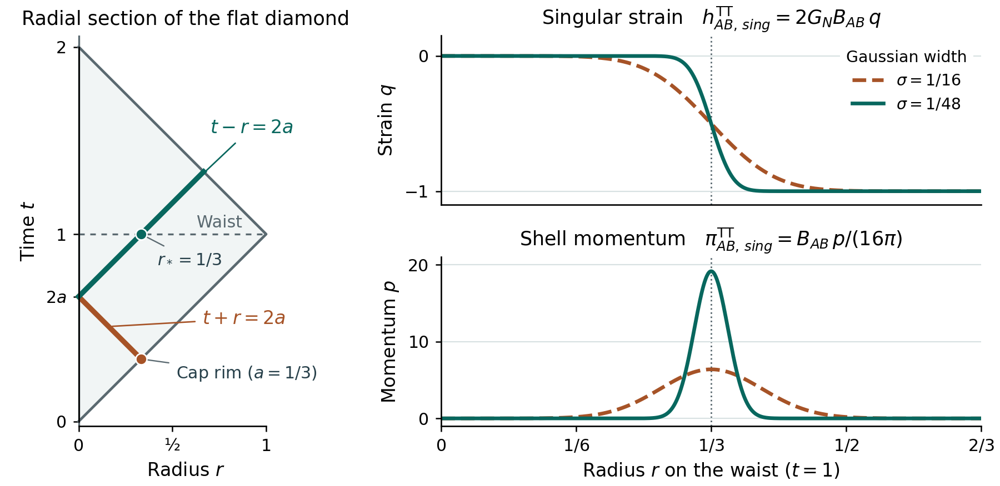

# A distributional gravitational field for a spherical clock

A light-cone clock measures the affine distance from its small cap to its waist, calibrated by the bundle expansion at the cap. We construct a distributional Einstein field whose symplectic pairing with each smooth vacuum probe reproduces the required clock variation. On a round flat diamond, the excess over the shear-free reading is stationary ($dD=0$), so its first nontrivial generator is the mixed second variation along a smooth reference wave. On a curved diamond, a single calibrated emitter already has a nonzero first variation. Both constructions use a shared smooth metric across the geometrically matched cuts. [Chandrasekaran, version 1, Eqs. (3.27)–(3.28)](https://arxiv.org/html/2611.34924v1#S3.E27) · [Why a smooth generator fails](rim-matching.md)

## A field one can calculate

Take a flat spherical diamond of waist radius $R$, with past tip at the origin, radial future null vector $k=(1,\mathbf n)$, and cap at affine distance $c=aR$. Subtract from the sky-averaged clock its shear-free reading $(1-a)M$ at the same weighted waist radius $M$, and call the difference $D$. Fix a smooth vacuum wave $W$ and let $H'_W$ be the affine derivative of its first-order conformal screen strain along each outgoing ray. Differentiating the focusing law gives, for every smooth vacuum probe $Z$,
$$
 L_W[Z]=d^2D(W,Z)
 =\frac14\left\langle\int_c^R s(R-s)\,H'_W:H'_Z\,ds\right\rangle .
$$
Brackets denote an average over the observer's unit sky. Because background shear vanishes in flat space, the first variation is zero and terms from moving cuts drop out of the Hessian. The calculation covers both polarizations and arbitrary angular profiles. [Optical derivation](weak-tidal.md)

An explicit distribution $J_W$ represents this functional on smooth metric tests. With parallel orthonormal screen vectors $e_A$, put $P_A^{\alpha\mu}=e_A^\alpha k^\mu-k^\alpha e_A^\mu$ and
$$
 K^{AB}(t,\mathbf n)=-\frac{t^2}{2}\int_{\max(c,t)}^R
                        \frac{R-s}{s}\,H'_W{}^{AB}(s,\mathbf n)\,ds .
$$
Integrating the linearized Weyl curvature against $K$ on the cone and transferring its two derivatives to the kernel yields
$$
 J_W^{\mu\nu}=-\frac12\partial_\alpha\partial_\beta
 \left\langle\int_0^R K^{AB}P_A^{\alpha\mu}P_B^{\beta\nu}
             \delta^{(4)}(x-tk)\,dt\right\rangle .
$$
The antisymmetric factors imply $\partial_\mu J_W^{\mu\nu}=0$ everywhere, including at the rim, as required for gauge invariance. In an exact check, the isolated rim term on a pure coordinate transformation evaluates to $-32/405$ while the full source gives zero. For the Einstein form $\Omega=\int\delta\pi\wedge\delta h$ with the generator in the first slot, the resulting Minkowski field is
$$
 X_W=32\pi G_N\,E J_W,\qquad
 E(t,\mathbf x)=\frac{\delta(t-|\mathbf x|)-\delta(t+|\mathbf x|)}
                       {4\pi|\mathbf x|},
$$
where $E$ is the retarded-minus-advanced inverse of $\partial_t^2-\Delta$. Because $J_W$ is both conserved and trace-free, $X_W$ is directly a de Donder representative obeying the homogeneous linearized Einstein equations as a distribution, with $\Omega(X_W,Z)=L_W[Z]$ on smooth vacuum probes. This construction uses a Weyl curvature representative on off-shell test metrics; matter would add Ricci focusing to the physical clock. [Metric source and sign](weak-tidal.md) · [Independent equal-time construction](weak-cauchy.md)

## What the field looks like

Set $R=1$, $a=1/3$, and choose a quadrupole reference with unit radial strain slope at the cap. In the transverse-traceless spatial gauge, the field on the waist slice carries an outward metric jump and a shell of canonical momentum. With $B_{ij}$ the transverse trace-free quadrupole screen tensor ($\langle B:B\rangle=3/5$) and $\pi_{ij}=\dot h_{ij}/(32\pi G_N)$, their leading singular parts at $r=1/3$ are
$$
 [h_{ij}]_{\rm out}=-2G_N B_{ij},\qquad
 (\pi_{ij})_{\rm shell}=\frac{B_{ij}}{16\pi}\,\delta(r-1/3),
$$
where the radial delta acts against $r^2dr\,d\Omega$. The shell propagates inward from the cap along a null characteristic, passes through the centre, and expands outward; smooth contributions also accompany it. In the single-packet experiment, the strain jump and momentum shell each supply $-1/60$, summing to the required $-1/30$. For a reference whose slope instead begins as $(s-a)^5$ at the rim (with unit leading coefficient), the leading strain jump vanishes, while a higher-derivative jump still yields the compensated-packet limit $-3/4$. A smooth compact source switched on and off inside the diamond realizes each individual packet in those limiting tests. [Radial reconstruction](weak-master.md) · [Wave normalization, vertex terms and energy](weak-normalization.md) · [Compact probes](weak-tidal.md)

For a local quadrupole reference with nonzero rim slope, the squared Minkowski one-particle norm diverges logarithmically with the ultraviolet cutoff $\Lambda$. With a smooth cutoff on the master profile equal to one near the rim $s=a$, $R=1$, and the normalization in the derivation, the coefficient of $\log\Lambda$ is $3G_N(1-a)^2|G'_W(a)|^2/(20\pi)$. This tests the coherent displacement of the linear response in a specified Fock representation; the nonlinear quantum clock and its spectral projection require separate domain arguments. [Norm calculation and numerical spectrum](weak-fock.md)

## A first derivative on a curved diamond

Whereas the flat calculation recovers the mixed second variation at a stationary background, a single emitter on a symmetric vacuum plane wave with a spherical two-tip diamond already has a nonzero first derivative. Fixing the emitter's locally measured Weyl superenergy $E_{ij}E^{ij}+B_{ij}B^{ij}$ leaves only local background isometries as residual freedom in the emitter's position and velocity, making the linear metric source conserved at the background. The functional still refers to the chosen emitter, and symmetry-breaking perturbations can distinguish different emitters.

The source $j[h]$ is explicit: one integrates an adjoint Jacobi equation along each ray, accounts for the displaced return-cone intersection, differentiates the fractional cap condition, and includes the perturbed freely falling worldline and launch calibration. Its support lies on the light-cone experiment. Applying the linearized Einstein causal propagator with the first-slot sign gives $X=-E_{\rm EH} j$. For cap fraction $1/2$ in the stated plane-wave units, smooth compact conserved probes give a limiting first-variation bracket of **$-0.060534188\ldots$**. Each probe is smooth at every positive width; limit and normalization differ from the flat quadrupole tests. [Curved source, calibration and probe](weak-curved.md) · [Two-tip geometry](joint-focal.md)

On this plane wave we can evaluate the causal propagator explicitly. Once the scalar wave factor and parallel transport are separated off, the matrix acting on the ten metric components is a polynomial of degree four in each transformed mode's transport generator. The five possible tensor-index grades explain why this calculation terminates. The position-space kernel has a direct term on the cone and a tail inside it. A gauge-fixed component can contain a tail even when considered apart from a physical source. The bracket reported above contracts the full tensor kernel with the conserved clock source. [Tensor Green function and numerical checks](weak-rosen-green.md) · [Harte's plane-wave Green function](https://arxiv.org/abs/1309.5020v2)

In a second curved example, in the Schwarzschild exterior, a short diamond ($R\ll m$) holds fixed a curvature-calibrated launch radius at $r=4m$ and the weighted waist radius $R$, with cap fraction $1/2$. Against a compactly continued outgoing vacuum quadrupole at the pole, its leading bracket coefficient in $R^5/m^4$ is $-39/204800$. Holding fixed the launch Weyl scalar $C_{abcd}C^{abcd}$ instead makes this $O(R^5)$ term vanish for every smooth vacuum perturbation. This calculation is linearized about a specified background event; averaging over equivalent points on the sphere defines a different observable. [Schwarzschild calibration and compact radiative probe](weak-schwarzschild.md)

## What has been constructed at the boundary

For a shared smooth metric across the cuts, the flat distribution admits a well-defined pairing using only smooth probe data extending to the closed waist disk. Conserved smooth sources approaching from inside the filled diamond give the same limit for the **sum** of the ordinary spacelike-cap and null-sheet currents. A source supported at the waist can produce zero field throughout the open diamond while still measuring curvature at the waist, which is why the closed disk is essential. Independently dynamical corner marks, freely prescribed face-by-face traces of a singular field, and a nonlinear flow on this space require additional structure. [Closed-diamond prescription and explicit counterexample](weak-boundary.md) · [Interior approximation on the symmetric plane wave](weak-curved-closure.md)

A single sharp generator pairs cleanly with smooth probes, whereas two sharp observables can have overlapping singularities that obstruct an ordinary numerical bracket. For a spherical electric Weyl detector, an explicit contact term proportional to the third derivative of a time delta arises; time smearing defines that measurement, though two positive equal-variance timing profiles can still produce a cross-bracket scaling as $d^{-4}$. The remaining physical task is to specify the allowed clock probes and their time resolution in the proposed quantum algebra, then determine whether the corresponding operators exist and what subspace their clock bounds select. [Domain and contact calculation](weak-domain.md)

The technical notes list commands and expected outputs for each calculation. From the repository root, run `python3 -B checks/weak_master.py` for the two flat packet limits, `python3 -B checks/weak_tidal.py` for the gauge and vacuum tests, and `make check` for the full suite. Generate the illustration with `uv run --script tools/plot_weak_shell.py` (output `weak-shell.png`). [Figure source](../tools/plot_weak_shell.py)
