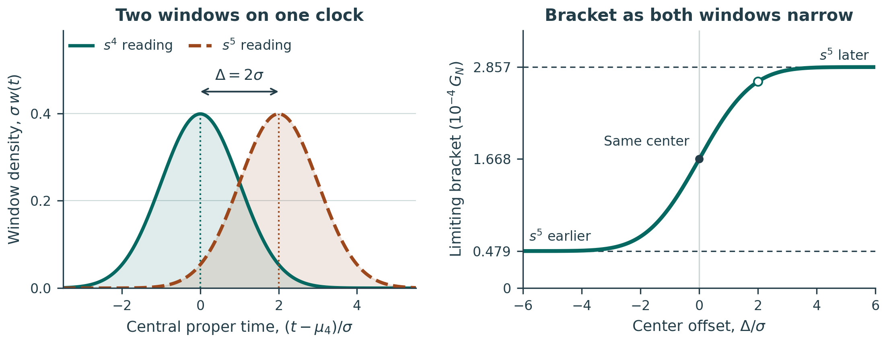

# Two light-cone clock readings at the same instant

Two clocks can share a timestamp even when their mutual gravitational response is nonzero. To specify a measurement, name the event or metric condition that defines the instant, state which light paths enter each reading, and say over what proper-time interval each readout responds. Wherever the optical experiment is regular, both classical readings are separately defined numbers on a given spacetime; their Poisson bracket does not restrict their simultaneous existence, but instead measures how the Hamiltonian deformation generated by one observable shifts the other. Here we determine when that *bracket* exists, what selects its value, how linearized flat-space responses relate to actual nonlinear clocks, and which conclusions survive quantization in a free graviton sector. [Chandrasekaran, v1, definition of the optical clock](https://arxiv.org/html/2611.34924v1#S3.E27) · [Distributional gravitational generator](spherical-generator.md)

## A prescription an observer can implement

On a flat round diamond of waist radius one, use the proper time of the central observer to translate the whole optical experiment, moving its marked emitter, tips, rays, waist, and incident reference wave together. A reading recorded at time $T$ averages translated experiments over a short proper-time window (for instance, ending at $T$). Give both channels the **same normalized, continuous timing window**, form their ordinary bracket at finite width, and then shorten the window. By bilinearity, the bracket of the two averaged readings integrates the separated-time bracket against the product of the two channel windows. Because swapping the two independent integration times leaves that product weight unchanged, the relative delay between two samples from a common continuous window is equally likely to have either sign—even when the window itself is asymmetric.

There is a causal way to synchronize different instruments. Suppose the first channel already averages with response $a$ and the second with $b$, both nonnegative, normalized and supported on past delays measured from the recorded time. Average the first output again using $b$ and the second using $a$. The two effective responses are $b*a$ and $a*b$, which are identical by commutativity of convolution. This uses only earlier completed readings. Their effective mean delays add, as do their timing variances when finite. Shortening both initial responses shrinks the resulting common window. If the widths are physically fixed, the prescription defines two finite-duration readings at the same recorded time. It assumes translation on the same proper-time axis and access to each readout's recent history. [Timing protocols and correlated triggers](timing-protocol.md)

## Why the midpoint can be nonzero

On a flat diamond, focusing is quadratic in shear, so the matched-radius clock excess $D=\bar u_*-(1-a)M$ has zero first derivative ($dD_{\rm flat}=0$). The flat-space observables analyzed here are therefore its *linearized response covectors* $L_i=d^2 D_{\rm flat}(W_i,\cdot)$ along smooth reference waves $W_i$ in the common real polar quadrupole polarization $S=\operatorname{diag}(-1/2,-1/2,1)$, with shared smooth cap-and-sheet matching and the decaying Minkowski radiative continuation. Let $B(\tau)=\{L_{1,0},L_{2,\tau}\}$ be their canonical bracket ($\{q,\pi\}=1$) when the second experiment takes place a proper time $\tau$ later. Writing $z_i$ for the fourth derivative of the master profile of each response, $d_i(x)$ for its right-minus-left jump at position $x$, and $A=3/(5120G_N)$ in units of waist radius one, the separated-time bracket is $B(\tau)=-A\int z_2(s-\tau/2)\,dz_1(s)$. Its one-sided limits exist:
$$
 B(0^\pm)=M\pm C,\qquad M=-A\int z_2^*\,dz_1,\qquad
 C=\frac A2\sum_x d_1(x)d_2(x).
$$
Here $z_2^*$ takes the arithmetic mean of the left and right limits at a jump, and $C$ arises solely from jumps shared by $z_1$ and $z_2$. For shrinking positive windows with an atomless relative delay, if the probability that the second reading comes later tends to $p$, the limiting bracket is $M+(2p-1)C$. A common proper-time window forces $p=1/2$, cancelling $C$ and selecting the midpoint $M=[B(0^+)+B(0^-)]/2$. Independently averaging the two observables weights delays by the product of their window densities; averaging the brackets of already paired trials instead depends on their joint trigger law and can introduce order bias even when both single-channel marginal windows are identical and symmetric. [Proof from bounded variation](timing-midpoint.md) · [Ordering and sampling](timing-protocol.md)

Take two distinct quadrupole references whose optical strain slopes on the measured sheet are $s^4$ and $s^5$. With cap fraction $1/3$ in this polarization, the synchronized midpoint bracket in the order $(s^4,s^5)$ is $8126G_N/48715425$. The later and earlier limits are approximately $2.8571\times10^{-4}G_N$ and $4.7899\times10^{-5}G_N$ respectively; both are positive. Antisymmetry exchanges the two *different* observables as well as the sign, whereas a reading paired with itself has a synchronized midpoint bracket of zero. [Full optical computation with both vertex and rim](timing-two-clocks.md)

## Two different caps on the very same light cone

On one incident quadrupole wave, compare the same spherical clock formula at two cap fractions $0<a<b<1$ while keeping the measured waist radius equal to one. Choose the reference strain slope $p(s)$ so that $\int_b^1 (s^{-1}-1)p(s)\,ds=0$. This condition removes the vertex jump of the outer-cap response $z_b$, leaving its only jump $d_b=-16G_N(1-b)p(b)$ at the outer rim $s=b$, where the inner-cap response $z_a$ is continuous. Because $z_a$ and $z_b$ share no jumps, $C_{ab}=0$: both time-ordered limits coincide, and every pair of shrinking timing windows yields the same sharp limit. Moreover, $z_a$ and $z_b$ agree identically above $b$ (where both clocks integrate the same wave to the waist), while on $0<s<b$ the derivative $dz_b$ is proportional to $s\,ds$, which integrates to zero against $z_a-z_b$ by the full-line optical moment identity $\int s(z_a-z_b)\,ds=0$. Subtracting the vanishing midpoint self-bracket of $z_b$ from $M_{ab}=A\int z_a^*\,dz_b$ therefore isolates the single outer-rim atom at $s=b$, where $z_a(b)=z_b(b+)$ differs from the midpoint trace $z_b^*(b)$ by $d_b/2$. In the order inner cap then outer cap, this gives
$$
 \{L_a,L_b\}(0)=\frac{A}{2}d_b^2=\frac{3G_N}{40}(1-b)^2p(b)^2.
$$
For $a=1/3$, $b=1/2$, and $p(s)=(152/3)s^4(1-26s/19)$ on $[a,1]$, the zero-vertex-jump condition holds and the outer rim slope is $p(1/2)=1$, yielding **$+3G_N/160$**; reversing the order gives $-3G_N/160$. Because $dD_{\rm flat}=0$, these $L_c$ are linearized Hessian responses to a common reference wave rather than first variations of the nonlinear clock itself. Along a regular noncaustic weak-wave family $g_\lambda=\eta+\lambda W+O(\lambda^2)$, wherever a differentiable finite-resolution reduced Poisson bracket exists at each fixed width $h>0$, this formula gives the leading $O(\lambda^2)$ coefficient of $\{D_{a,h},D_{b,h}\}(g_\lambda)$ in the sequential limit $\lambda\to0$ first and $h\to0$ second; whether the reverse limit ($h\to0$ at fixed $\lambda\neq0$) exists remains open. [General identity and exact checks](timing-caps.md)

The cap spacing and the temporal resolution can be varied together. With spacing $\varepsilon=b-a$ and common Gaussian windows of individual rms width $h$, the bracket tends to $(3G_N/160)\operatorname{erf}(x)$ along sequences with $\varepsilon/h\to x$ in the calibrated unit-radius example. Distinct resolved rims ($x\to\infty$) recover the full value, whereas unresolved coincident rims ($x\to0$) give zero. Rectangular windows give a different crossover that can be integrated exactly. [Derivation and finite-width predictions](timing-cap-spacing.md)

A second calibration changes only the radial wave slope, to $p(s)=48s(1-s)(2s-1)$. It cancels the inner reading's vertex jump and the outer reading's rim jump. The result is **$-3G_N/160$** for the same instruments in the same order. More generally, for distinct nested caps on one wave the product of their two vertex jumps fixes the entire dependence on trigger order. [General two-cap identity and both signed predictions](timing-caps.md)

## Actual clocks on curved spacetimes

The two cap clocks have nonzero first variations on the following curved background. In a vacuum Kasner universe with three periodic spatial directions, take a spherical diamond of fixed weighted waist radius $M=R$ around each comoving emitter, using the same two tips for both cap fractions, and average each reading over emitter positions with the normalized spatial volume measure. Translation and reflection symmetry collapse each clock differential $d\mathcal U_\epsilon$ on all smooth vacuum perturbations to two smooth background-family covectors, $u_{\epsilon,b}\,db+u_{\epsilon,t}\,dt_*$, where $b$ parametrizes the Kasner exponents and $t_*$ is the selected common midpoint slice. Because both covectors admit smooth compact spacetime sources, the ordinary sharp Peierls bracket is well-defined without timing smearing and equals $\{b,t_*\}(u_{1,b}u_{2,t}-u_{1,t}u_{2,b})$.

Different epoch-selection rules can pick the *exact same slice* $t_*=T$ in the reference spacetime yet move differently under metric variation, which changes $\{b,t_*\}$ and therefore the sharp bracket. Fixing curvature age sets $dt_*=0$, and fixing total spatial volume leaves $t_*$ invariant along the Hamiltonian flow of $b$; both rules therefore give an exact zero bracket at every admissible radius. By contrast, fixing the torus length selected by the smallest mean squared norm of a primitive harmonic one-form couples $t_*$ to the anisotropic expansion along that axis, making $\{b,t_*\}\neq0$. Because the leading $O(R^5)$ focusing terms share parallel $(b,t_*)$-gradients, the subleading $O(R^6)$ cap-dependent terms supply the first nonzero bracket, which is **strictly positive for sufficiently small $R/T$** for any ordered pair $0<\epsilon_1<\epsilon_2<1$. For $1/3,1/2$,
$$
 \{\mathcal U_{1/3},\mathcal U_{1/2}\}
 =\frac{8\pi G_N T}{V_T}
  \left[\frac{488}{1286491815}\frac{R^{11}}{T^9}
     +O\!\left(\frac{R^{12}}{T^{10}}\right)\right] .
$$
Here $T$ is the central background age, $V_T$ is the torus volume at that age, and $R/T\ll1$. [Optical derivation and torus normalization](timing-kasner.md)

For **single localized emitters**, a separate spherical plane-wave construction gives an exact zero for two overlapping, reflection-related clocks. For sufficiently nested clocks on one emitter, the causal field of the larger clock is smooth across the entire smaller diamond, ensuring that a timing-window-independent sharp bracket exists without yet evaluating its numerical value. These comparisons rely on the stated common background midpoint, separation conditions, and surrounding vacuum continuation. In the polarized cylindrical vacuum model, two actual opposite-face clocks (and also two same-face clocks at a calibrated curvature) have strictly positive sharp brackets in the worked finite-curvature preparations; their symmetry orbits are tori. [Localized spherical preparations](timing-curved.md) · [Cylindrical calculation](timing-nonlinear.md)

## What a joint quantum reading would cost

Classically, both readings are simultaneously defined numbers whenever the experiment is regular, and $B_h$ measures their canonical cross-response rather than measurement error. In the free linearized Minkowski graviton Fock representation, smoothing each linear response over a finite timing window of width $h>0$ yields self-adjoint field quadratures with commutator $[R_1,R_2]=i\hbar B_h$. Two distinct quantum effects then arise:

- **Added joint-readout noise from noncommutativity.** A nonzero $B_h$ excludes a joint sharp projective readout of both quadratures. They still admit an unbiased simultaneous noisy readout (POVM) by coupling to an auxiliary canonical pair: in the additive Gaussian construction, the added-noise covariance has determinant at least $(\hbar B_h/2)^2$ (attained by a pure Gaussian auxiliary state, e.g., balanced added variance $\hbar|B_h|/2$ per channel). This bound stays finite as $h\downarrow0$ whenever $B_h$ has a finite limit, and measures extra meter noise on top of the fluctuations already present in the gravitational state. [Joint measurement construction](timing-readout.md)
- **Diverging intrinsic single-clock vacuum variance.** Even measuring a *single* clock becomes singular as its response time vanishes. For the calibrated unit-slope, zero-vertex-jump reference at $a=1/3$, halving a sufficiently short smooth timing width increases the vacuum variance by $\hbar G_N\log(2)/(30\pi)$ to leading order. At nonzero coupling the associated Weyl unitaries converge weakly to zero and have no strong limit. This excludes a strong-resolvent limit of these quadratures to a self-adjoint sharp clock. A finite classical coincidence bracket—and finite limiting added meter noise—therefore coexists with divergent individual quantum fluctuations in this representation. Separately, while the midpoint defines an algebra for the specified classical linear readings, imposing an exact Weyl algebra for all sharp proper-time translates with nonzero contact requires a nonseparable representation and excludes strongly continuous time translations. [Vacuum fluctuations](timing-quantum.md) · [Algebraic scope and no-go theorem](timing-algebra.md)

The remaining gravitational question is whether an independently framed cap and sheet provide a covariant measurement and a differentiable bracket on a neighborhood of general metrics. Specifying an observer, a common clock epoch, and the temporal response are necessary in the examples above. Constructing a quantum operator for the original nonlinear clock, and counting the states below its ceiling, remain open. [Research questions](../THEORY.md)
